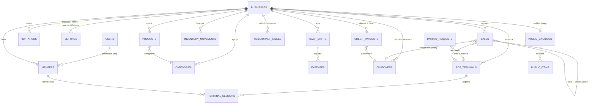

# Modelo de datos (Firestore)

Todo cuelga del negocio (`businessId`). Los esquemas Zod de cada entidad son la fuente única
(`features/*/domain/*.ts`); las reglas replican tipos y campos permitidos.

| Ruta                                                | Campos principales                                                                                                                                                                                                                                    | Notas                                                            |
| --------------------------------------------------- | ----------------------------------------------------------------------------------------------------------------------------------------------------------------------------------------------------------------------------------------------------- | ---------------------------------------------------------------- |
| `users/{uid}`                                       | displayName, email, businessIds[]                                                                                                                                                                                                                     | `businessIds` es índice de conveniencia, no autorización         |
| `businesses/{bid}`                                  | name, type, currency, timezone, ownerUid (null si lo creó la plataforma), plan (`free\|premium`), status (`active\|blocked\|deleted`)                                                                                                                 | moneda y tipo inmutables                                         |
| `…/members/{uid}`                                   | displayName, email, role, extraPermissions[], status, customRoleId, seatId                                                                                                                                                                            | autorización (ADR 0004)                                          |
| `…/invitations/{email}`                             | email, role, extraPermissions[], businessId, businessName                                                                                                                                                                                             | id = email normalizado                                           |
| `…/settings/modules`                                | restaurant, customers                                                                                                                                                                                                                                 | módulos activables                                               |
| `…/settings/taxes`                                  | pricesIncludeTax, defaultRateBps, rates[]                                                                                                                                                                                                             | tasas en puntos básicos                                          |
| `…/settings/paymentMethods`                         | enabled[]                                                                                                                                                                                                                                             |                                                                  |
| `…/products/{id}`                                   | name, sku, barcode, categoryId, priceMinor, costMinor, taxRateBps, trackStock, stock, lowStockThreshold, active, imageUrl                                                                                                                             | `stock` solo cambia con `increment()`                            |
| `…/categories/{id}`                                 | name, color (tono del sistema), sortOrder                                                                                                                                                                                                             |                                                                  |
| `…/inventoryMovements/{id}`                         | productId, type (sale/void/adjustment/purchase), quantityDelta, reason, saleId, supplierId (solo `purchase`)                                                                                                                                          | inmutable                                                        |
| `…/suppliers/{id}`                                  | name, phone, email                                                                                                                                                                                                                                    |                                                                  |
| `…/customers/{id}`                                  | name, documentId, phone, email, notes                                                                                                                                                                                                                 |                                                                  |
| `…/cashShifts/{id}`                                 | status, deviceCode, openedBy/At, openingFloatMinor, closedBy/At, countedCashMinor, expectedCashMinor, notes                                                                                                                                           |                                                                  |
| `…/cashShifts/{id}/expenses/{id}`                   | amountMinor, description                                                                                                                                                                                                                              | inmutable                                                        |
| `…/sales/{id}`                                      | type (sale/void), number, deviceCode, lines[] (snapshot), subtotalMinor, discountMinor, taxMinor, totalMinor, payments[] (método incl. `credit`), changeMinor, creditMinor, customerId, cashShiftId, terminalId, voidedSaleId, voidReason, occurredAt | **inmutable**; anular = documento `void-<id>` (único)            |
| `…/creditPayments/{id}`                             | customerId, amountMinor, method, cashShiftId (turno abierto), occurredAt                                                                                                                                                                              | abono a fiado; inmutable                                         |
| `…/seats/{1\|2\|3}`                                 | uid                                                                                                                                                                                                                                                   | cupo de trabajador según el plan (gratis 1, premium 3; ADR 0015) |
| `…/settings/setup`                                  | completedSteps[], skippedSteps[], dismissedAt, completedAt                                                                                                                                                                                            | asistente de configuración inicial (ADR 0014)                    |
| `…/tourProgress/{uid}`                              | status (`done\|skipped`)                                                                                                                                                                                                                              | el tour se muestra una vez por persona                           |
| `…/settings/publicCatalog`                          | enabled, slug, title, description, whatsapp, showOutOfStock, visibleProductIds[], emailProvider (`app\|gmail\|outlook\|custom`), emailCustomUrl                                                                                                       | lo que el dueño decide publicar                                  |
| `publicCatalogs/{slug}`                             | businessId, enabled, title, description, whatsapp, currency                                                                                                                                                                                           | raíz; **lectura sin sesión** si `enabled` (ADR 0012)             |
| `publicCatalogs/{slug}/products/{productId}`        | name, priceMinor, imageUrl, categoryName, available, sortOrder                                                                                                                                                                                        | proyección pública; la escribe quien tiene `catalog.manage`      |
| `terminalPairingRequests/{sha256(código)}`          | deviceUid, deviceUuid, deviceType, status (`pending\|approved\|cancelled`), businessId, approvedBy/At, createdAt                                                                                                                                      | raíz; vence a los 5 min de `createdAt`; uso único                |
| `…/posTerminals/{uid anónimo}`                      | deviceUuid, deviceType, name, status (`active\|disabled\|revoked`), idleLockMinutes, pairingRequestId, registeredBy, authorizedAt, lastSeenAt, revokedAt                                                                                              | solo se crea junto con la aprobación (mismo batch)               |
| `…/terminalSessions/{id}`                           | terminalId, memberUid, loginMethod (`password`), status (`active\|closed\|expired`), startedAt, endedAt, lastActivityAt                                                                                                                               | se cierra una vez; nunca se reabre                               |
| `…/restaurantOrders/{id}`                           | tableId, tableName, status (`open\|sent\|served\|paid\|cancelled`), guests, lines[] (con `round`), round, notes, saleId, openedAt, sentAt, servedAt, closedAt                                                                                         | comanda; sin borrado                                             |
| `…/restaurantZones/{id}`, `…/restaurantTables/{id}` | name, sortOrder / name, zoneId, seats, status                                                                                                                                                                                                         |                                                                  |

Todos los documentos llevan `createdAt`, `updatedAt` (`serverTimestamp()`, las reglas exigen
`== request.time`), `createdBy` (`== request.auth.uid`) y `schemaVersion` (hoy `1`).

## Convenciones

- **IDs en cliente** (`doc(collection(...)).id`): funcionan sin conexión.
- **Dinero** en enteros `*Minor` (ADR 0005). **Fechas** como `Timestamp`; el dominio usa `Date`
  (los converters convierten). La zona horaria del negocio es solo de presentación (L11).
- **Snapshot en ventas**: cada línea guarda nombre, precio unitario e impuesto del momento.
- **Converters** (`zodConverter`): validan con Zod en lectura; las escrituras validan su entrada con
  el esquema `*Input` del formulario antes del repositorio.
- **Índices**: las consultas actuales usan índices simples; `firestore.indexes.json` declara el
  índice de _collection group_ para `invitations.email`.
- **Migraciones**: subir `SCHEMA_VERSION` exige un ADR y un script de migración.
