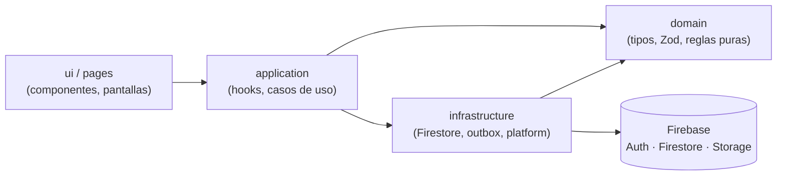
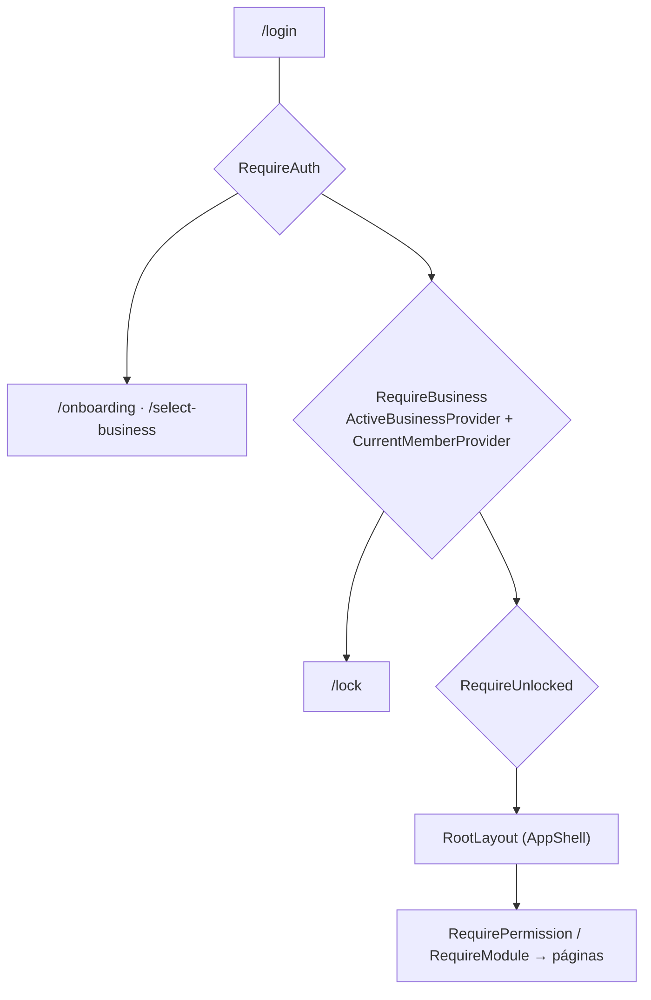

# Visión general de la arquitectura

SuperPOS es una SPA/PWA estática (React + Vite) que habla directamente con Firebase. No hay
servidor propio (ADR 0002). El código se organiza **por features** y, dentro de cada una, **por capas**.

## Capas

| Capa              | Contiene                                                             | Puede importar                                                     |
| ----------------- | -------------------------------------------------------------------- | ------------------------------------------------------------------ |
| `domain/`         | Entidades, esquemas Zod, `Money`, máquinas de estado, cálculos puros | solo `domain` (propio y `shared/domain`)                           |
| `application/`    | Hooks y casos de uso; providers de contexto                          | `domain`, su `infrastructure`, `shared`                            |
| `infrastructure/` | Repositorios Firestore, handlers del outbox                          | `domain`, `shared/infrastructure`                                  |
| `ui/`, `pages/`   | Componentes y pantallas                                              | `application`, `domain`, `shared/ui`, `shared/lib`, `shared/hooks` |

Reglas que **ESLint hace cumplir** (`eslint.config.js`, `import-x/no-restricted-paths`):

- `domain` no importa nada fuera de `domain` ni React ni Firebase.
- `ui/` y `pages/` no importan `infrastructure/` (pasan por `application/`).
- Solo `infrastructure/` importa `firebase/*`. Nada importa APIs de Node ni Electron en `src/`.
- Una feature importa otra **solo por su `index.ts`**; `app/` también.
- `shared/` no depende de `features/` ni de `app/`.
- Atomic design en `shared/ui`: dependencias solo hacia niveles inferiores (ver
  [atomic-design](../design-system/atomic-design.md)).

## Composición de la app (`src/app/`)

- `main.tsx` inicializa Firebase (falla con una pantalla de configuración si faltan `VITE_*`) y
  registra el Service Worker.
- `AppProviders`: TanStack Query (`networkMode: 'offlineFirst'`), sesión, monitor de sincronización,
  outbox, tema y toasts.
- `router.tsx`: rutas con carga diferida (`lazy`) y guardas anidadas:

## Datos en tiempo real

`useLiveQuery(queryKey, subscribe)` (en `shared/hooks`) integra `onSnapshot` con la caché de
TanStack Query: la primera carga da estados de carga y error; la suscripción mantiene la caché
actualizada. Los repositorios exponen `Subscribe<T>` (tipo de `shared/domain/live.ts`), así la UI
no conoce Firebase. Las escrituras son optimistas y se registran con `trackWrite` (ver
[offline-sync](offline-sync.md)).

## Dónde seguir

- Estructura de carpetas: [folder-structure.md](folder-structure.md)
- Modelo de datos: [data-model.md](data-model.md)
- Seguridad: [security.md](security.md)
