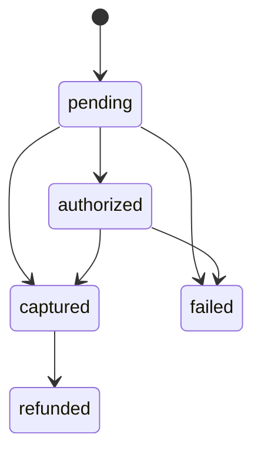
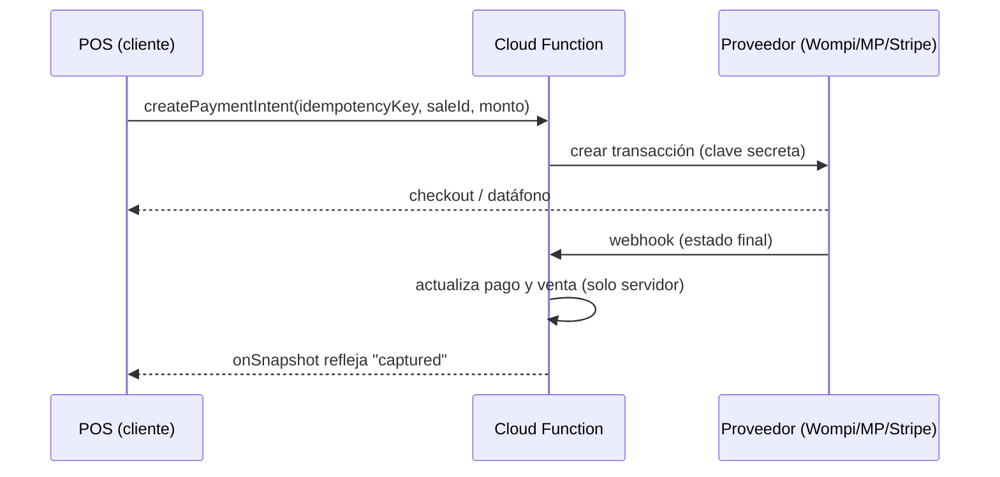

# Pagos

Esta fase diseña el **puerto**, no la integración con un proveedor.

## Dominio (`shared/domain/payment.ts`)

- `PaymentMethod`: `cash | card | transfer | wallet | other`.
- `PaymentStatus` y su máquina de estados:



- `summarizeTenders(total, tenders)`: pago mixto; solo el efectivo puede exceder el total (vuelto).
- `worksOffline(method)`: `cash` y `other`.

## Puerto (`shared/infrastructure/payments/`)

```ts
interface PaymentProvider {
  readonly methods: readonly PaymentMethod[];
  readonly requiresNetwork: boolean;
  createPaymentIntent(req: {
    idempotencyKey;
    amount;
    currency;
    method;
    reference;
  }): Promise<Result<PaymentIntent>>;
  confirm(intentId, idempotencyKey): Promise<Result<PaymentIntent>>;
  refund(intentId, idempotencyKey): Promise<Result<PaymentIntent>>;
  getStatus(intentId): Promise<Result<PaymentIntent>>;
}
```

- **Idempotencia**: misma `idempotencyKey` con los mismos datos devuelve el mismo intent; con datos
  distintos, `AppError('idempotency_conflict')` (`PaymentLedger`).
- `CashPaymentProvider`: captura al instante, sin red.
- `MockCardPaymentProvider`: requiere red; `pending → authorized → captured`; montos terminados en
  13 se rechazan para probar errores.

## Flujo futuro con servidor



El cliente **nunca** guarda claves secretas. Sin conexión no hay pagos electrónicos (ADR 0007).
